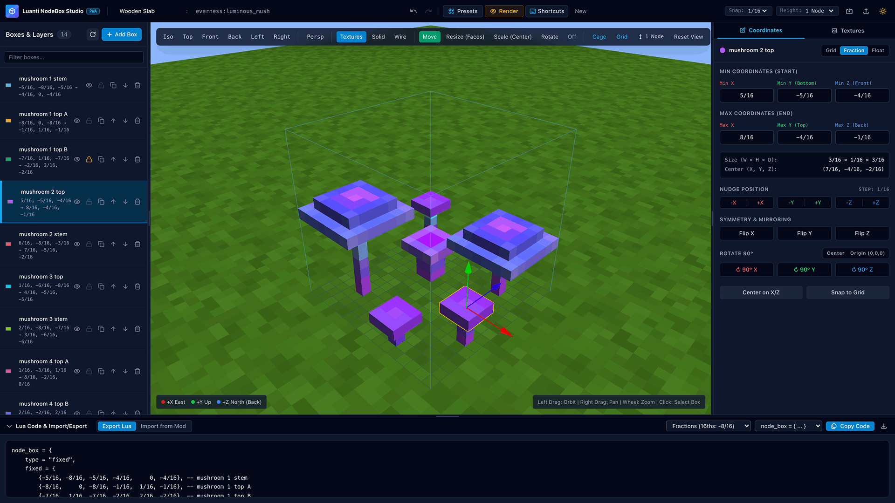

# Luanti NodeBox Studio

<p align="center">
  <a href="https://sakel-hub.github.io/luanti-nodebox-studio/">
    
  </a>
</p>

<p align="center">
  <a href="https://sakel-hub.github.io/luanti-nodebox-studio/"><strong>🚀 Launch Live Web App</strong></a> &bull;
  <a href="#-features">Features</a> &bull;
  <a href="#-keyboard-shortcuts">Shortcuts</a> &bull;
  <a href="#-getting-started">Getting Started</a> &bull;
  <a href="#-luanti-coordinates-reference">Coordinates Reference</a> &bull;
  <a href="#-contributing--translations">Contributing & Translations</a>
</p>

<p align="center">
  <a href="https://github.com/sakel-hub/luanti-nodebox-studio/actions/workflows/deploy.yml">
    
  </a>
  
  
  
  
</p>

---

A modern, accessible, offline-first 3D visual editor and Progressive Web App (PWA) built with **Angular 22+** and **Babylon.js 9+** for designing, inspecting, texturing, importing, and exporting **Luanti** (formerly Minetest) nodebox models.

---

## ✨ Features

### 🎮 Interactive 3D Viewport (Babylon.js)
- **1x1x1 Node Reference Cage**: Real-time visual boundaries (`[-0.5, 0.5]` range) with an optional 2-node boundary mode.
- **16x16 Subdivided Floor Grid**: Coordinate axis indicators (`+X` East, `+Y` Up, `+Z` North / Back).
- **Orbit, Pan, Ortho & Preset Cameras**: Instant switching between Perspective and Orthographic (`5`) projection, plus Isometric, Top, Front, Back, Left, and Right views.
- **Render Modes**: Switch between Solid Color, Wireframe, and 6-Face Textured modes with normal relief lighting.
- **Transform Gizmos**: Move (`W`), Rotate 90° (`E`), Scale (`R`), Face Resize (`T`), and 3D Raycast Paint (`P`) tools with 1/16th, 1/32nd, and 1/64th grid snapping.
- **Connected, Wallmounted & Leveled Simulation**: Interactive 3D neighbor ghost-block toggles (`+X`, `-X`, `+Y`, `-Y`, `+Z`, `-Z`), wall/floor/ceiling attachment previews, and leveled height sliders (`1/16` to `16/16`).

### 🌅 Render Studio, Luanti Skybox & 3D Pixel Extrusion
- **Cubic Luanti Skybox & Atmosphere**: Switch between **Studio**, **Day**, **Sunset**, and **Night** environments with a vertically-subdivided cubic skybox, interactive Sun Elevation (`4°–85°`), Sun Azimuth (`0°–360°`), Atmospheric Haze, 3D Blocky Sun & Moon, upper-hemisphere 3D Voxel Stars, and solid 24×24 drifting **3D Luanti Voxel Clouds**.
- **3D Pixel Art Depth & Per-Style Sliders (`5%–100%`)**:
  - **Pixel Bevel (Mosaic)**: Crisp per-pixel step borders.
  - **Luminance Relief**: Sobel/Scharr surface normal relief.
  - **3D Pixel Extrusion (Voxel)**: Greedy-meshed 3D voxel geometry extruded directly from each nodebox face based on pixel luminance, with calibrated `Subtle (20%)`, `Medium (45%)`, and `Deep (85%)` quick presets.
- **High-Res Screenshot Studio**: Export `1080p`, `4K Ultra-HD`, or `512×512` transparent inventory icon PNGs, plus 360° Turntable presentation mode.

### 🎨 6-Face Texture Studio, 2D Pixel Painter & 3D Painting
- **Luanti 6-Face Mapping**: Maps to Luanti's cube tile order: `+Y` (top), `-Y` (bottom), `+X` (right), `-X` (left), `+Z` (back), `-Z` (front).
- **2D Pixel Painter & 3D Raycast Painting (`P`)**: Create custom `16×16`, `32×32`, or `64×64` textures or paint directly on 3D nodebox faces in real time with Pencil, Eraser, Flood-Fill Bucket, Eyedropper, Line, and Pixel Noise tools, complete with undo/redo and PNG export.
- **Animated Vertical Sprite Sheets**: Live preview and Lua export for `vertical_frames` animated textures.
- **UV Projection & Face Rotation**: Align, flip (U/V), and rotate (0°, 90°, 180°, 270°) texture faces per individual box.
- **Built-in & Custom Palettes**: Includes default Luanti textures (Wood Planks, Stone, Cobble, Brick, Dirt, Glass, Steel, Grass, Mese) and allows custom PNG/JPG image uploads cached locally.

### 🗂️ Layers & Box Hierarchy
- **Layer Management**: Add, clone, rename, hide/show, lock, and delete individual boxes.
- **Color Coding**: Custom per-box display colors for visual clarity while modeling.
- **Box Reordering**: Drag or button-assisted layer ordering for clean organization.

### 📐 Coordinate & Dimension Inspector
- **Dual-Mode Inputs**: Work in **Grid Units** (`-8 to +8`), **Fractions** (`-8/16`, `5/16`), or **Float Decimals** (`-0.5 to +0.5`).
- **Nudge & Resolution**: Fine-tune position and dimension with adjustable snap resolution ($1/16$, $1/32$, $1/64$).
- **Symmetry & Mirror Tools**: One-click symmetry mirrors (`Flip X`, `Flip Y`, `Flip Z`) for rapid symmetric modeling (e.g. table legs, chairs, lanterns).

### 💻 Lua Code Generator & Live Importer
- **Luanti Modern Standard**: Generates standard `core.register_node(...)` definitions with support for importing both modern `core.` and legacy `minetest.` code.
- **Multiple Output Formats**:
  - `16ths Fractions`: `{-8/16, -8/16, -8/16, 8/16, 0/16, 8/16}`
  - `Divisible 16/8`: `{-4/8, -4/8, -4/8, 4/8, 0/8, 4/8}`
  - `Simplified Fractions`: `{-1/2, -1/2, -1/2, 1/2, 0, 1/2}`
  - `Float Decimals`: `{-0.5, -0.5, -0.5, 0.5, 0.0, 0.5}`
  - `Grid Integers`: `{-8, -8, -8, 8, 0, 8}`
- **Live Importer**: Paste any Lua snippet from an existing mod—handles arithmetic fractions (`-8/16`), comments (`--`), and extracts node names & tiles.

### 📚 Presets Library
- Built-in starting templates: Slab, Stairs, Pillar / Column, Wooden Chair, Fence / Gate, and Torch.

### ⚡ Offline PWA & Ergonomics
- **Offline First**: Fully functional offline via `@angular/service-worker`.
- **Installable**: Install as a standalone desktop or mobile application.
- **Auto-Save & Project Files**: Automatically preserves your workspace in `localStorage` and supports exporting/importing JSON project files.
- **Resizable Panels**: Adjustable layout splitters for layers, inspector, and code drawer.

---

## ⌨️ Keyboard Shortcuts

All keyboard shortcuts are customizable in the **Keyboard Shortcuts (`?`)** dialog.

| Shortcut | Action |
| :--- | :--- |
| <kbd>Q</kbd> | Select Mode (Gizmo Off) |
| <kbd>W</kbd> | Move (Translate) Tool |
| <kbd>E</kbd> | Rotate Tool (orthogonal 90° snaps) |
| <kbd>R</kbd> | Scale Tool |
| <kbd>T</kbd> | Resize Face Bounds Tool |
| <kbd>P</kbd> | 3D Texture Paint Tool |
| <kbd>G</kbd> | Toggle Floor Grid |
| <kbd>C</kbd> | Toggle 1×1×1 Node Reference Cage |
| <kbd>5</kbd> | Toggle Orthographic / Perspective Camera |
| <kbd>F</kbd> | Reset Camera View |
| <kbd>N</kbd> | Add New NodeBox |
| <kbd>D</kbd> | Duplicate Selected Box |
| <kbd>H</kbd> | Hide / Show Selected Box |
| <kbd>Delete</kbd> / <kbd>Backspace</kbd> | Delete Selected Box |
| <kbd>Ctrl</kbd> / <kbd>Cmd</kbd> + <kbd>Z</kbd> | Undo |
| <kbd>Ctrl</kbd> / <kbd>Cmd</kbd> + <kbd>Y</kbd> | Redo |
| <kbd>?</kbd> | Toggle Keyboard Shortcuts Dialog |

---

## 🚀 Getting Started

### Prerequisites
- Node.js 24 LTS (`v24.16.0+`)
- npm 11+

### Installation & Development
```bash
# Clone the repository
git clone https://github.com/sakel-hub/luanti-nodebox-studio.git
cd luanti-nodebox-studio

# Install dependencies
npm ci

# Start development server
npm start
```
Open [http://localhost:4200](http://localhost:4200) in your browser.

### Run Unit Tests
```bash
npm run test
```

### Production & PWA Build
```bash
npm run build
```
Optimized static files will be generated in `dist/luanti-nodebox/browser`.

---

## 📐 Luanti Coordinates Reference

| Direction | Luanti Axis | Tile Face Index |
| :--- | :--- | :--- |
| **Top** | `+Y` (Up) | `1` |
| **Bottom** | `-Y` (Down) | `2` |
| **Right** | `+X` (East) | `3` |
| **Left** | `-X` (West) | `4` |
| **Back** | `+Z` (North) | `5` |
| **Front** | `-Z` (South) | `6` |

A standard full Luanti node cube occupies the coordinate range `[-0.5, 0.5]` in all three axes:
$$-0.5 = -\frac{8}{16} \qquad \text{and} \qquad +0.5 = +\frac{8}{16}$$

---

## 🤝 Contributing & Translations

Contributions of all kinds are warmly welcomed! We are especially grateful for community help with **translations** into additional languages.

Luanti NodeBox Studio currently supports English, Slovak, German, French, Spanish, and Russian. Adding a new language or improving existing translations is simple and type-safe.

- **Developer Guide**: Check out [CONTRIBUTING.md](CONTRIBUTING.md) for full step-by-step instructions on adding language files (`src/app/core/i18n/locales/`), running parity checks, and submitting Pull Requests.
- **No Coding Required**: Have translation suggestions or want to add a language? Feel free to open a [Translation Issue](https://github.com/sakel-hub/luanti-nodebox-studio/issues/new?template=translation.yml) and our maintainers will integrate it!

---

## 📄 License

This project is licensed under the [MIT License](LICENSE.txt).
